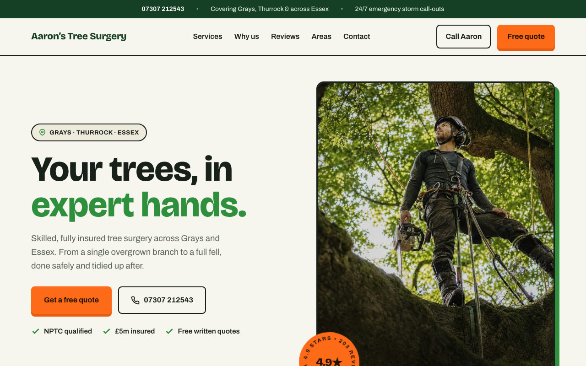
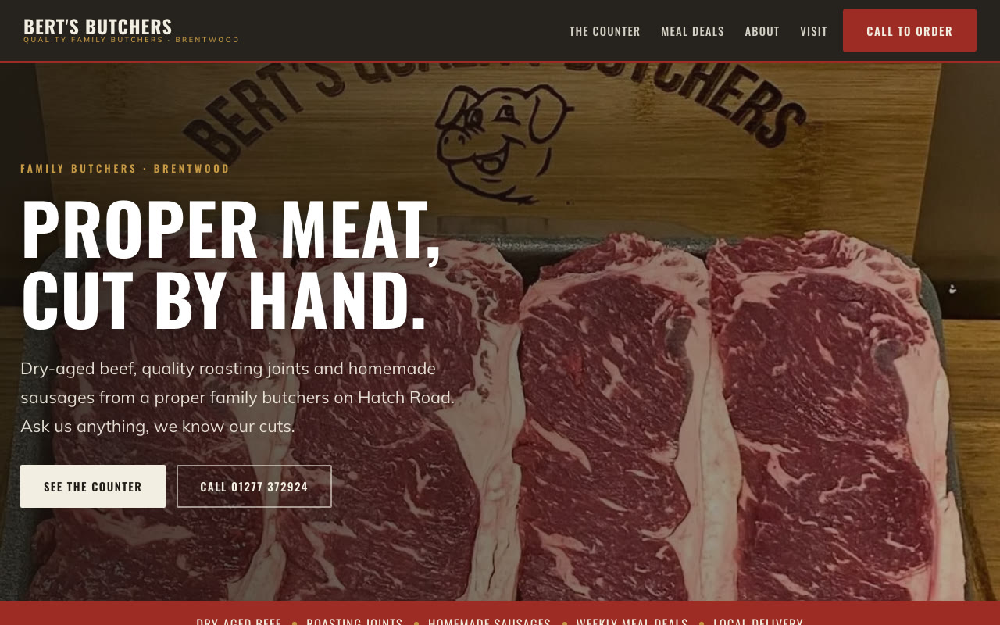
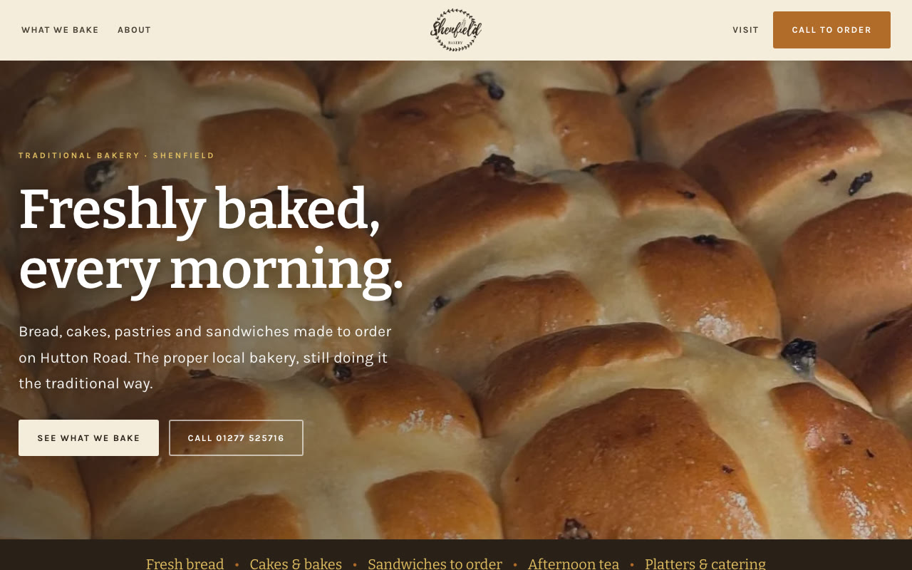

# Local business websites

21 demo websites for independent businesses around Brentwood and Essex.

  
  
  

  
  
  

> These are speculative demos. I built each one unprompted to show a business what its site could look like. None was commissioned and none is the business's official site.

## How each one is made

1. Find a local business that is trading but has no proper website.
2. Take the brand from what it already has: logo, colours, photos and reviews from its social pages.
3. Build a one-page, mobile-first site around what its customers need: what it does, proof it is good, and how to call.
4. Put it online and send the owner the link.

## A selection

| Business type | Demo |
|---|---|
| Tree surgeon | [essex-web-demos.web.app/aarons](https://essex-web-demos.web.app/aarons/) |
| Mobile mechanic | [essex-web-demos.web.app/hmv](https://essex-web-demos.web.app/hmv/) |
| Butcher | [essex-web-demos.web.app/bertsbutchers](https://essex-web-demos.web.app/bertsbutchers/) |
| Bakery | [essex-web-demos.web.app/shenfieldbakery](https://essex-web-demos.web.app/shenfieldbakery/) |
| Domestic cleaner | [essex-web-demos.web.app/sallys](https://essex-web-demos.web.app/sallys/) |
| Italian restaurant | [essex-web-demos.web.app/pastasciutta](https://essex-web-demos.web.app/pastasciutta/) |

## How they were built

Plain HTML and CSS, hosted on Firebase, built with AI coding tools. I choose the businesses, set the design direction for each, and do the outreach.
