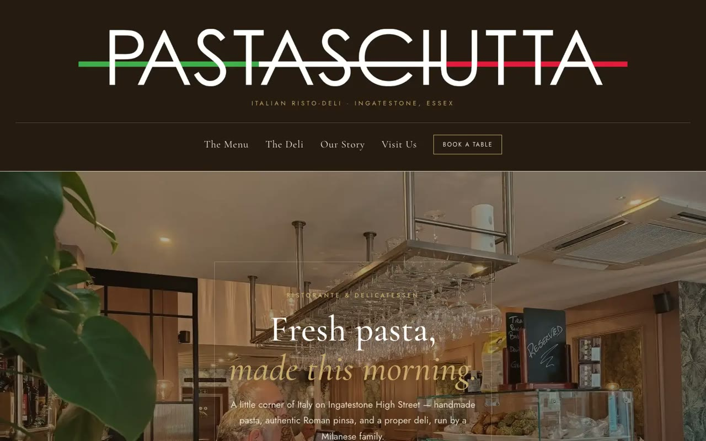
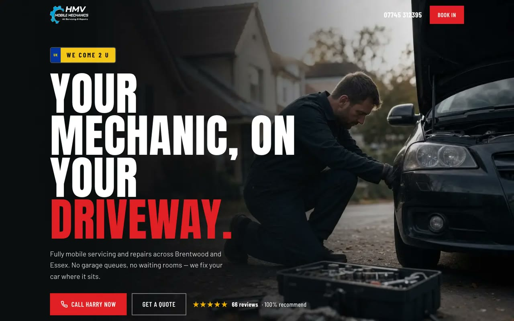
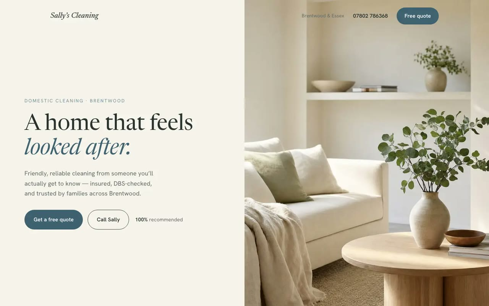
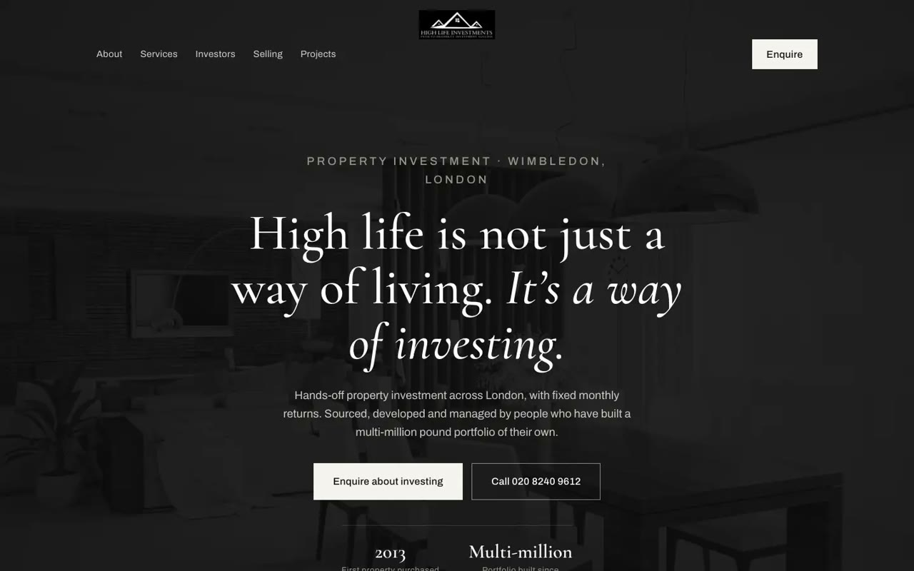
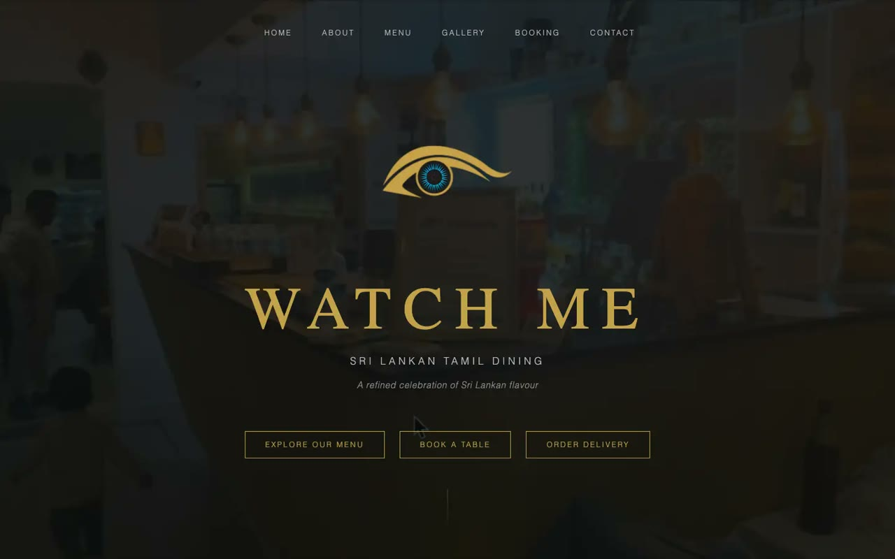
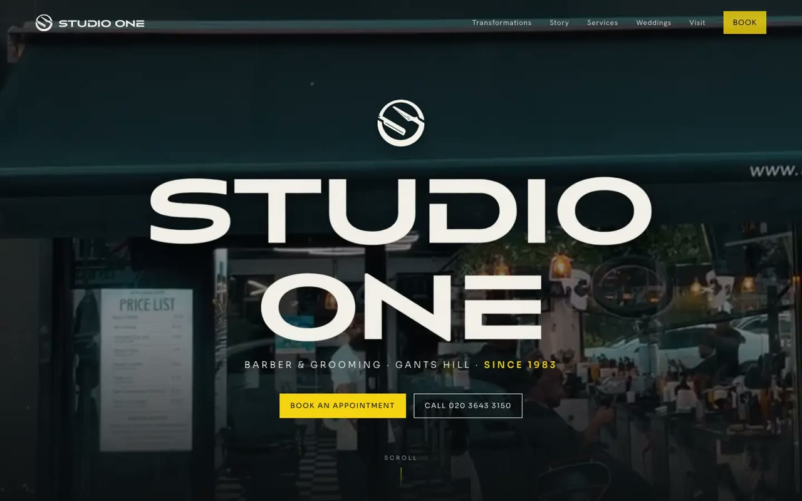

# Local business websites

24 demo websites for independent businesses, mostly around Brentwood and Essex.

> These are speculative demos. I built each one unprompted to show a business what its site could look like. None was commissioned and none is the business's official site.

<table>
  <tr>
    <td width="50%" valign="top">
      
      <b>Pastasciutta</b> · Italian deli 
      The Ingatestone risto-deli: pasta, wine and a room you can almost smell from the homepage.
    </td>
    <td width="50%" valign="top">
      
      <b>HMV Mobile Mechanics</b> · Mobile mechanic 
      Bold and direct in the business's own red and cyan, built to bring in bookings.
    </td>
  </tr>
  <tr>
    <td width="50%" valign="top">
      
      <b>Sally's Cleaning</b> · Domestic cleaner 
      Light, warm and calm, making a small cleaning business look established.
    </td>
    <td width="50%" valign="top">
      
      <b>High Life Investments</b> · Property investment 
      A discreet, monochrome rebrand for a Wimbledon property firm.
    </td>
  </tr>
  <tr>
    <td width="50%" valign="top">
      
      <b>Watch Me</b> · Fine dining 
      An elegant black and gold site for a Sri Lankan Tamil restaurant in Wimbledon.
    </td>
    <td width="50%" valign="top">
      
      <b>Studio One</b> · Barber 
      Barber and grooming in Gants Hill: sharp, local and easy to book.
    </td>
  </tr>
</table>

The other 18 cover a tree surgeon, a personal trainer, gyms, a lash studio, a roofer, a plasterer, a cake maker, a builder, a butcher, a bakery, a photographer, a nail salon and several restaurants and bars.

## How each one is made

1. Find a local business that is trading but has no proper website.
2. Take the brand from what it already has: logo, colours, photos and reviews from its social pages.
3. Build a one-page, mobile-first site around what its customers need: what it does, proof it is good, and how to call.
4. Put it online and send the owner the link.

## How they were built

Plain HTML and CSS, hosted on Firebase, built with AI coding tools. I choose the businesses, set the design direction for each, and do the outreach.
